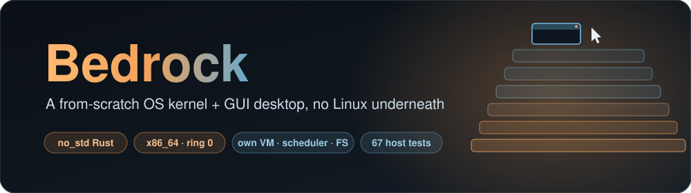
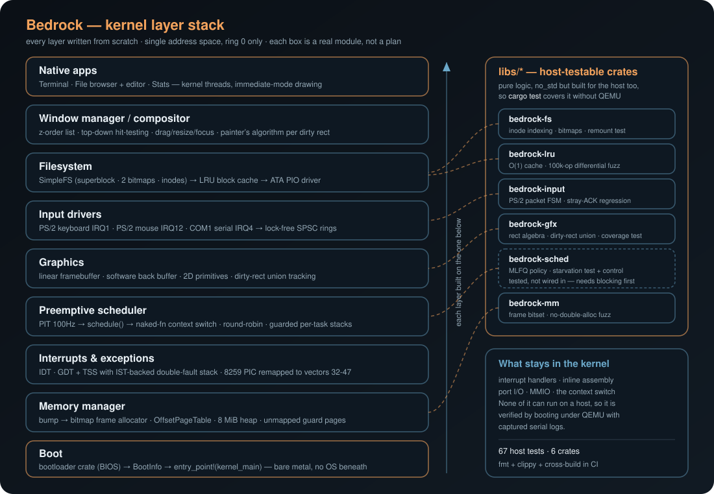
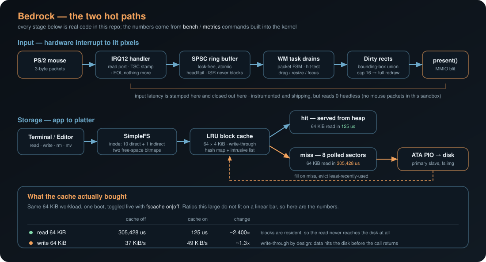

<div align="center">



<br/>

[](https://www.rust-lang.org/)
[](#quickstart)
[](#what-this-is--is-not)
[](#testing)
[](https://github.com/SanyamWadhwa07/BEDROCK/actions/workflows/ci.yml)

</div>

A `no_std` Rust operating system kernel, booted from bare metal with no Linux (or any other OS) underneath: its own bootloader integration, physical/virtual memory manager, interrupt handling, preemptive scheduler, framebuffer graphics stack with dirty-rect compositing, PS/2 input drivers, a window manager, and native GUI apps (a terminal, a combined file browser/text editor) backed by a real on-disk filesystem over a hand-rolled ATA PIO driver.

Built as a systems-engineering portfolio project: the goal is to be a genuine kernel + GUI desktop in the lineage of [Redox OS](https://www.redox-os.org/) or the ["Writing an OS in Rust"](https://os.phil-opp.com/) (blog_os) series taken further, not a Linux-hosted simulation and not a "custom Linux distro" (real Linux kernel + custom desktop environment).

## Measured results

Every number below comes from `bench` and `metrics` commands built into the kernel itself, so anyone who boots it can reproduce them. Raw serial captures are in [`docs/benchmarks/`](docs/benchmarks/). Sandbox is QEMU 11.0 with no hardware acceleration (pure TCG software emulation), so absolute figures are pessimistic and the comparisons are the meaningful part.

| | Result | How |
|---|---|---|
| **Context-switch latency** | **~251-269 cycles** per one-way switch | 200,000 switches against a dedicated fiber, bypassing the scheduler so 50ms time slices can't dominate |
| **LRU block cache, read** | **305,428 us -> 125 us** (~2,400x) | Same 64 KiB workload with `fscache` on vs off, one boot |
| **Dirty-rect vs full redraw** | **679 ms -> 14.3 ms** per frame (~47x) | `redraw naive` forces the strawman at runtime; captured back-to-back |
| **Allocator throughput** | **~1.34M** alloc/free ops/sec | 200 rounds of heap churn plus frame alloc/free |
| **Raw ATA PIO** | **87 KiB/s** write, **378 KiB/s** read | 256 KiB sequential, TSC cross-checked against PIT ticks |
| **Scheduler fairness** | 7 tasks, **14% CPU each**, identical switch counts | Round-robin under a deliberately hostile busy-loop task |
| **Filesystem persistence** | Survives across independent boots | Three separate QEMU processes: write, read back byte-for-byte, rename, delete |
| **Host test coverage** | **67 tests** across 6 `no_std` crates | `cargo test`, no QEMU needed, run in CI |

Two caveats stated up front rather than buried: absolute frame time varies by more than an order of magnitude between boots in this sandbox, so only the back-to-back A/B is meaningful; and input latency is instrumented but reads zero here, because a headless QEMU generates no mouse packets.

## What this is / is not

**Is:**
- A real kernel: its own GDT/IDT/TSS, its own two-stage physical frame allocator + virtual memory manager, its own preemptive round-robin scheduler with a hand-written `naked fn` context switch, its own framebuffer graphics + dirty-rect compositor, its own IRQ-driven PS/2 keyboard/mouse drivers, its own window manager, its own on-disk filesystem (SimpleFS) over a hand-rolled ATA PIO driver.
- Single-address-space, **ring-0-only, monolithic**: every task (drivers, window manager, apps) is a kernel thread. There is no syscall boundary, no ELF loader, no per-process page tables, no ring-3 isolation. This is the single biggest, deliberately-documented scope cut versus a microkernel or versus Redox's process model -- see [DESIGN.md](DESIGN.md) for the full reasoning. Cutting ring-3 isolation put a multi-month subproject's worth of time back into the GUI stack instead.
- Single-core (no APIC/SMP), BIOS boot only (no UEFI), no networking, no USB.

**Is not:** a Linux distribution, a hypervisor guest OS, or anything with process isolation or a security boundary between "apps." Every window-manager app in this kernel could read every other task's memory if it wanted to -- there is no MMU-enforced separation between tasks, only cooperative convention.

## Architecture

<div align="center">

</div>

The same thing as text, if you prefer to grep it:

```
Native Apps: Terminal | File Browser + Text Editor   (kernel threads, immediate-mode drawing)
Window Manager / Compositor: z-order, hit-test, drag/resize, focus routing -> dirty-rect merge
Filesystem: SimpleFS (superblock/inode/bitmap) -> LRU block cache (write-through) -> ATA PIO driver
Input Drivers: PS/2 keyboard (IRQ1) | PS/2 mouse (IRQ12) | COM1 serial (IRQ4) -> lock-free SPSC ring buffers
Graphics: linear framebuffer, back-buffer, 2D primitives, bitmap font, dirty-rect compositing
Scheduler: PIT timer IRQ -> schedule() -> naked-fn context switch, round-robin ready queue
Interrupts/Exceptions: IDT, GDT+TSS+IST double-fault stack, remapped 8259 PIC
Memory Manager: two-stage frame allocator (bump -> bitmap), OffsetPageTable, heap bootstrap
Boot: `bootloader` crate (BIOS) -> BootInfo -> entry_point!(kernel_main)
```

Each layer is built on a named, classic data structure or algorithm -- see [DESIGN.md](DESIGN.md#dsa--algorithms-map) for the full map (bitmap allocator, round-robin circular queue, rectangle-union dirty tracking + painter's algorithm, lock-free SPSC ring buffer, a PS/2 packet-reassembly finite state machine, shallow-fanout inode indexing, and more).

## Quickstart

Requires a pinned nightly Rust toolchain (see `rust-toolchain.toml`, installed automatically by `rustup` on first build) and QEMU (`qemu-system-x86_64`) on `PATH`.

```
cargo xtask run              # debug build, boots in QEMU
cargo xtask run --release    # release build -- much faster to boot; recommended
```

The first run creates `fs.img`, a disk image holding SimpleFS's 4 MiB plus a small scratch region past it that `bench ata` writes to. It is reused rather than recreated on every subsequent run, so filesystem writes persist across reboots exactly like a real second hard disk. Delete it by hand to force a fresh format.

Once booted, the on-screen window manager starts with three windows:

- **Stats**: live scheduler task counters, compositor FPS and frame time, and a bouncing box.
- **Terminal**: `ls`, `cat <name>`, `write <name> <text>`, `rm <name>`, `mv <old> <new>`, and `df` against the real filesystem.
- **Editor**: arrow keys and Enter to open a file from the listing, `n` for a new one, `D` to delete the selected one, type to edit, F2 to save, Escape to go back to the listing.

Drag titlebars to move windows, drag the bottom-right corner to resize, click the red button to close.

A serial debug shell runs on COM1 alongside the GUI, driven by IRQ4 rather than polling. Besides the original `help` / `echo` / `meminfo` / `alloctest` / `fault <breakpoint|page|gpf|double>`, it now exposes the instrumentation the benchmarks below were captured with:

| Command | What it does |
|---|---|
| `bench <ata\|alloc\|fs\|ctxswitch\|all>` | Runs the in-kernel benchmark suite and prints timings. Every number in the table below is reproducible this way. |
| `metrics` | Live compositor FPS, frame time, input latency, and block-cache hit/miss counters. |
| `fscache <on\|off>` | Enables or disables the LRU block cache at runtime, so the same workload can be measured both ways in one boot. |
| `redraw <naive\|dirty>` | Forces a full-screen repaint every frame, or restores dirty-rect compositing. This is what makes the compositing decision measurable instead of merely asserted. |
| `tasks` | Per-task switch counts and CPU share, for checking scheduler fairness. |

The benchmarks are wired into the shipped kernel rather than living in a temporary harness that gets deleted after capture, which is how the earlier phases' numbers were produced.


## Benchmarks

All numbers below were captured in this project's actual development sandbox: QEMU 11.0 on Windows, **no hardware acceleration available (pure TCG software emulation)** -- meaningfully slower than KVM/WHPX-accelerated QEMU or real hardware would be, especially for anything CPU- or I/O-instruction-heavy like PIO transfers. Treat the absolute numbers as sandbox-specific, not representative of real-hardware performance; the methodology and relative comparisons (e.g. write vs. read) are still meaningful.

Everything marked Phase 9 comes from the `bench` and `metrics` commands built into the shipped kernel, so anyone who boots it can reproduce them. Cycle-level timings go through a TSC calibrated against the PIT at boot, cross-checked against raw tick counts.

The two paths those numbers describe, end to end:

<div align="center">

</div>

### Block cache, on versus off

The same `bench fs` workload (create, write 64 KiB, read back, list, delete), run in one boot with the cache warm and then with `fscache off`. The point of the comparison is that it is one-sided in exactly the way write-through predicts: reads collapse, writes barely move.

| Operation | Cache off | Cache on (warm) | Change |
|---|---|---|---|
| Read 64 KiB | 305,428 us (~209 KiB/s) | **125 us (~512,000 KiB/s)** | ~2,400x |
| List directory | 2,958 us | **51 us** | ~58x |
| Create file | 13,466 us | **12,204 us** | ~1.1x |
| Write 64 KiB | 1,689,687 us (~37 KiB/s) | **1,284,509 us (~49 KiB/s)** | ~1.3x |
| Delete file | 1,032,961 us | **866,899 us** | ~1.2x |

Reads become memory-speed once blocks are resident. Writes gain only the incidental speedup of their read-modify-write of the bitmaps and inode hitting cache, because the data itself still goes to disk before the call returns. A cold first pass through this workload measured 87,912 KiB/s on read (67 cache hits, 5 misses) against 512,000 KiB/s fully warm.

### Dirty-rect compositing versus naive full redraw

Design decision #5 was the bet that dirty-rect bookkeeping pays for itself. `redraw naive` forces the strawman (mark the whole screen dirty every frame) at runtime, so both modes can be measured in the same boot, against the same three windows, with the same animation running.

| Mode | FPS | Frame time (last) | Frame time (worst in 1s) |
|---|---|---|---|
| Naive full redraw | 1 | 679,058 us | 714,616 us |
| Dirty-rect | 5 | 14,303 us | 14,457 us |

**About 47x on frame time.** The gap is this wide because the screen is 1280x720 at 3 bytes per pixel, so a full repaint moves ~2.7 MB through the compositor and then across the MMIO framebuffer every frame, while a typical frame here only actually changes a cursor and a couple of small window regions. Under TCG software emulation the MMIO copy is especially expensive, so treat 47x as the sandbox's number rather than a universal one. The direction is not sandbox-specific.

The absolute FPS is low in both modes for the same reason everything else here is slow: no hardware acceleration, and the compositor is one of seven round-robin tasks sharing a single emulated core.

**Read the ratio, not the absolute frame time.** Both rows above come from one boot, minutes apart, which is the only reason they can be compared. Across *different* boots the same unmodified code has measured anywhere from 14ms to 329ms per frame in this sandbox, with no stray QEMU processes and the host under 15% load. TCG throughput depends on host scheduling in ways nothing inside the kernel controls. Any single frame-time number here is worth very little on its own; an A/B captured back-to-back in one boot is worth something.

## Testing

- **Host-testable logic**: the algorithms that are pure logic rather than hardware access live in `no_std` crates under `libs/`, built for the host as well as the kernel, and covered by ordinary `cargo test` (36 tests, run in CI on every push):
  - `bedrock-mm`: the frame-allocator bitset. Includes a randomized alloc/free stress test asserting the property the kernel's stability rests on, that a frame is never handed out twice before being freed.
  - `bedrock-gfx`: rectangle algebra and the dirty-rect union. Includes a randomized test that whatever the tracker returns always covers every pixel that was marked dirty, since under-coverage would leave stale pixels on screen.
  - `bedrock-input`: the PS/2 mouse packet FSM, including a regression test for the stray 0xFA ACK byte that desynchronized the stream during Phase 5.
  - `bedrock-lru`: the filesystem block cache, checked against a naive reference model over 100,000 randomized operations.
  - `bedrock-sched`: the MLFQ scheduling policy. Asserts demotion, per-level quanta, and that a priority boost rescues a starved CPU-bound task, with a control test confirming the same task genuinely starves without boosting. Not currently wired into the kernel; see the scheduling note under known limitations.
  - `bedrock-fs`: the SimpleFS layout itself, generic over a `BlockDevice` so the tests can hand it an in-memory disk. Covers inode indexing through the single-indirect block, both free-space bitmaps, and the free-and-reallocate paths, asserting on block and inode accounting so a leak fails the test. Includes a remount check, which is the same property Phase 7 demonstrated by launching a second QEMU process, now runnable in milliseconds on the host.

  What deliberately stayed in the kernel binary is the part that cannot run on a host: interrupt handlers, inline assembly, port I/O, and MMIO. The 8042 controller dance stays in `kernel/src/input/mouse.rs` and only the byte-stream decoding moved out; likewise `kernel/src/fs/simplefs.rs` is now just the ATA-backed block device, the global mount, and the lock that serializes tasks.

  Extracting the filesystem immediately paid for itself. `write_file` freed every one of a file's data blocks *before* validating that the new contents would fit, so an over-large write returned an error having already marked those blocks free in the bitmap, while the inode still pointed at them. The next file created would be handed blocks aliased to an existing one. The test that caught it (`rejects_a_file_larger_than_the_layout_allows`) asserts the rejected write changes nothing, which is the kind of check that is hard to even express while the code is welded to a disk driver.
- **Bare-metal verification**: every phase was verified by an actual QEMU boot with captured serial output, not just "it compiles." Where this sandbox had no path to live interactive keyboard/mouse input, a temporary self-test exercised the real production code paths directly (constructing real `WindowManager`/`SimpleFS` state and asserting on it), was captured passing, and was then deleted -- see PLAN.md's progress log for each phase's captured pass/fail output. The one genuine bug the sandbox's limits couldn't fully rule out is real interactive GUI behavior (drag/resize/type by hand) -- someone with a real display and PS/2-capable QEMU frontend should exercise this directly before calling it fully proven.
- **Fault injection**: the serial shell's `fault <breakpoint|page|gpf|double>` commands deliberately trigger each exception class and verify the kernel produces a clean diagnostic instead of a silent triple-fault reboot.

## Repository layout

```
kernel/         the kernel itself (see kernel/src/{memory,task,graphics,input,wm,fs}/)
libs/           host-testable no_std crates: bedrock-{mm,gfx,input,lru,fs,sched}
xtask/          build + QEMU launch tooling (`cargo xtask run`)
docs/benchmarks/  raw serial captures behind every number quoted above
docs/assets/    banner.svg · architecture.svg · dataflow.svg
PLAN.md         the full phased build plan and a detailed, dated progress log with every
                real bug found during bring-up and how it was diagnosed and fixed
DESIGN.md       locked design decisions, the hardest components explained, the DSA map,
                and an interview-defense checklist for every major tradeoff
```
